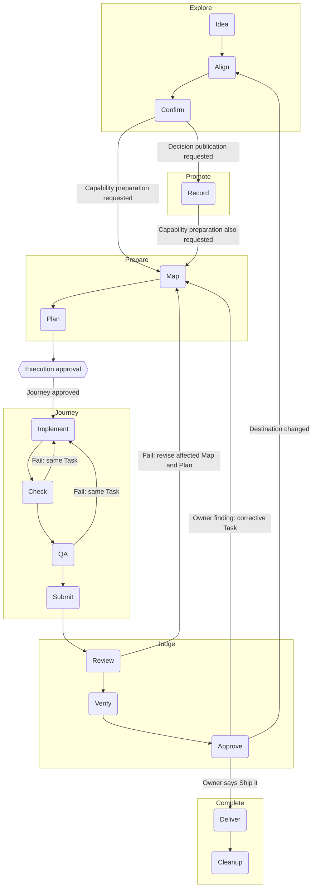

# Workflows

Use this section for workflows; [workflow-reference](workflow-reference.md) provides the surrounding context.

## Workflows

Look up a workflow verb by name below. Each entry links the verb's definition,
lists its steps in order with the skill or command that carries each, and says
where the workflow loops when a step fails or comes back "not yet". The diagram
maps how the six workflows connect; [Prototype](workflow-reference.md#prototype) sits outside it.
The entries add no authority and replace no safeguard: the linked skills and
commands carry the procedures.

Maintain these entries with the project's confirmed workflows. When a confirmed
workflow or a verb changes, update its entry here.

| Workflow | Verbs |
|---|---|
| Explore | Idea -> Align -> Confirm |
| Promote | Record -> Publish |
| Prepare | Map -> Plan |
| Journey | Implement -> Check -> QA -> Submit |
| Judge | Review -> Verify -> Approve |
| Complete | Deliver -> Cleanup |

Confirmed means Human Verified Intent; Approved means Human Reviewed Work. Two
owner judgments sit between workflows rather than inside them: the scoped
execution approval that leaves Prepare, and “Ship it”, the permission to deliver
the specific work under discussion. Neither is a stage, and neither substitutes
for Confirm or Approve. The owner takes part through these same verbs; Human QA
is how the owner performs Approve, not an extra stage.

Publication applies around the workflow, without repeated boxes in the map.
Each completed authorized step leaves a durable checkpoint through a PR to
integration. Each run preserves remaining meaningful progress in a PR, with
unfinished status and missing checks clear. [Publish](workflow-reference.md#publish) ends at checked
integration landing; opening the PR and another host receiving the change are
separate events. A step, handoff or checkpoint does not require a separate agent.

### Align

Defined in the [Glossary](../../../GLOSSARY.md) term **Align**.

**Steps:** ask the most consequential open question with a recommended answer
([grilling](../grilling/SKILL.md#each-decision-in-order)) ->
wait for the owner's answer -> read it back as pending -> lock it once the owner
confirms and update the decision map
([grilling](../grilling/SKILL.md#the-decision-map)) -> repeat
until the frontier is empty.

**Loop:** a corrected readback is revised and read back again before anything
locks; a changed premise reopens only the decisions it affects. Align ends only
at [Confirm](workflow-reference.md#confirm). An owner send-back at [Judge](workflow-reference.md#judge) returns here
at the scope it implicates.

### Approve

Read [Approve](workflow-reference--workflows--approve.md#approve) when working on this topic.

### Check

Read [Check](workflow-reference--workflows--check.md#check) when working on this topic.

### Cleanup

Read [Cleanup](workflow-reference--workflows--cleanup.md#cleanup) when working on this topic.

### Complete

Defined in the [Glossary](../../../GLOSSARY.md) term **Complete**.

**Steps:** [Deliver](workflow-reference.md#deliver) -> [Cleanup](workflow-reference.md#cleanup)
([director](../director/SKILL.md#owner-closure-and-reconciliation)).

A Spec records real delivery and cleanup work as Task records carrying
`**Phase:** post-delivery` and acceptance lines under
`### Post-delivery acceptance`
([to-tasks](../to-tasks/SKILL.md#process)). The Spec gate, Review and Approve
do not wait for them; `complete` does.

**Loop:** `complete` refuses, leaving state untouched, until every post-delivery
Task is done with proof, every acceptance line is checked and the approved
content is unchanged on `origin/main`. A later gap is a new Spec under its
landmark or the Blueprint.

### Confirm

Defined in the [Glossary](../../../GLOSSARY.md) term **Confirm**.

**Steps:** Read back the concept, meaning and intended endpoint
([grilling](../grilling/SKILL.md#finishing-honestly)) -> record the owner's
explicit confirmation -> take only the authorized exit: decision publication,
capability preparation or approved implementation
([grilling](../grilling/SKILL.md#exits)).

**Loop:** A correction gets a revised readback; silence never confirms. Confirm ends [Explore](workflow-reference.md#explore) and establishes understanding. It grants neither implementation permission nor proof of delivery.

### Deliver

Defined in the [Glossary](../../../GLOSSARY.md) term **Deliver**.

**Steps:** Read the owner's Ship it for the specific approved candidate ->
claim the post-delivery Task, which refuses unless a passed Review and the
owner's approval bind the current content -> perform only that authorized main
action -> fetch main and verify the approved content and required checks
([director](../director/SKILL.md#owner-human-qa-and-main-before-complete)).

**Loop:** Without Ship it, stop at integration with the approved candidate
held. A changed candidate or failed required check returns to the affected
work and needs fresh Review and approval. Integration landing alone is not
delivery; “Ship it” authorizes the specific work, not unrelated integration
content.

### Explore

Defined in the [Glossary](../../../GLOSSARY.md) term **Explore**.

**Steps:** [Idea](workflow-reference.md#idea) -> [Align](workflow-reference.md#align) -> [Confirm](workflow-reference.md#confirm)
([grilling](../grilling/SKILL.md)).

**Loop:** Before leaving Explore, obtain explicit owner confirmation of the readback, scope, constraints and endpoint. Until the owner confirms, Explore keeps aligning, and a correction or
a changed premise goes back into Align. Confirm ends Explore; the request determines whether [Promote](workflow-reference.md#promote),
[Prepare](workflow-reference.md#prepare) or a nearer endpoint follows.

### Idea

Defined in the [Glossary](../../../GLOSSARY.md) term **Idea**.

**Steps:** take the owner's thought in the owner's words -> explore it in
conversation until it is clear enough to align -> open [Align](workflow-reference.md#align)
([grilling](../grilling/SKILL.md)).

**Loop:** an idea not yet clear enough to align stays in conversation; nothing
it says is settled until [Confirm](workflow-reference.md#confirm).

### Implement

Defined in the [Glossary](../../../GLOSSARY.md) term **Implement**.

**Steps:** situate with `doctor`, `next --json` and `show S-###`
([implement](SKILL.md#1-situate-the-slice)) ->
`claim S-### --agent NAME` -> add the smallest failing test and watch it go
red -> make the smallest change that turns it green, then refactor while green
([implement](SKILL.md#2-drive-the-behavior)) ->
update the owning documentation and record a `receipt`.

**Loop:** a failed [Check](workflow-reference.md#check) or [QA](workflow-reference.md#qa) comes back here in the same
Task. When no confident next action can be established, record the blocker in
the Task and stop.

### Jot

Read [Jot](workflow-reference--workflows--jot.md#jot) when working on this topic.

### Journey

Defined in the [Glossary](../../../GLOSSARY.md) term **Journey**.

**Steps:** [Implement](workflow-reference.md#implement) -> [Check](workflow-reference.md#check) -> [QA](workflow-reference.md#qa) ->
[Submit](workflow-reference.md#submit)
([implement](SKILL.md#4-review-at-the-relevant-boundary),
once per Task; [carry](../carry/SKILL.md) or a
[handoff](../handoff/SKILL.md) brings an authorized assignment
to it).

**Loop:** a failed Check or QA continues the same Task. [Review](workflow-reference.md#review), on
the assembled Spec and never on a Task, decides whether another Journey runs:
a failed Review sends the work back through [Map](workflow-reference.md#map) and [Plan](workflow-reference.md#plan) into
a new Journey.

### Judge

Read [Judge](workflow-reference--workflows--judge.md#judge) when working on this topic.

### Lane Sweep

Read [Lane Sweep](workflow-reference--workflows--lane-sweep.md#lane-sweep) when working on this topic.

### Map

Read [Map](workflow-reference--workflows--map.md#map) when working on this topic.

### Plan

Read [Plan](workflow-reference--workflows--plan.md#plan) when working on this topic.

### Prepare

Defined in the [Glossary](../../../GLOSSARY.md) term **Prepare**.

**Steps:** [Map](workflow-reference.md#map) -> [Plan](workflow-reference.md#plan)
([to-spec](../to-spec/SKILL.md),
[to-tasks](../to-tasks/SKILL.md#process)).

**Loop:** Preserve and publish each completed result under the shared publication rule. Reuse an adequate existing Map or Plan. Before leaving Prepare, present the mapped and planned work, proof and limits and obtain the owner's explicit, scoped execution approval; it is distinct from the later [Approve](workflow-reference.md#approve) inside Judge. Stop at prepared work unless that approval already covers Journey. One response may satisfy both judgments; [recover sources](execution-authority.md) rather than infer permission.

### Promote

Defined in the [Glossary](../../../GLOSSARY.md) term **Promote**.

**Steps:** [Record](workflow-reference.md#record) -> [Publish](workflow-reference.md#publish)
([to-docs](../to-docs/SKILL.md),
[implement](SKILL.md#branch-completion)).

**Loop:** Correct the affected record and repeat its checks before landing. Stop at the published decision; [Prepare](workflow-reference.md#prepare) runs only when requested. Interrupted work resumes from its preserved status, without mandatory author or publisher handoffs.

### Prototype

Defined in the [Glossary](../../../GLOSSARY.md) term **Prototype**. Outside the diagram: it fits before [Confirm](workflow-reference.md#confirm) or between Confirm and [Plan](workflow-reference.md#plan).

**Steps:** name the one question it answers -> build a throwaway that starts
with one command and shows its state
(the room's run command, the `run` entry of its manifest `legibility`
declaration) -> show the owner the answer -> take the answer back to the verb
it was called from.

**Loop:** the answer returns to Align, Confirm or Map, wherever the question
came from; a question it does not settle gets another prototype or goes back to
the owner. Prototype code reaches the product only through an ordinary
[Journey](workflow-reference.md#journey).

### Publish

Defined in the [Glossary](../../../GLOSSARY.md) term **Publish**.

**Steps:** Commit meaningful progress -> push and open or update its PR to integration -> run checks appropriate to its content and required review at the assembled capability boundary -> merge when eligible -> fetch integration, prove containment and read the changed owners back
([implement](SKILL.md#branch-completion)).

**Loop:** A failed check or review returns to the affected work. Keep unfinished or failing progress in a PR with its status clear; do not merge merely to preserve it. Publish is finished only after checked integration landing. A PR opening and another host fetching or pulling are separate events.

### QA

Defined in the [Glossary](../../../GLOSSARY.md) term **QA**.

**Steps:** compare the scoped diff with the Task's outcome and acceptance ->
exercise the real behavior the Task asked for, past what Check proved ->
check the documentation and Receipt claims against the proof -> say what you
judged and what you could not
([implement](SKILL.md#4-review-at-the-relevant-boundary)).

**Loop:** a defect QA finds goes back to [Implement](workflow-reference.md#implement) and
[Check](workflow-reference.md#check) in the same Task; a gap the Task cannot close is named in the
second merge answer as more needed or a new Task.

### Record

Defined in the [Glossary](../../../GLOSSARY.md) term **Record**.

**Steps:** Identify the claim's proper existing owner -> preserve intent, knowledge, decisions, progress or evidence with its source, status and history -> check fidelity and links
([to-docs](../to-docs/SKILL.md)). Text that carries an owner-confirmed readback first records it verbatim as a shared confirmed-intent jot, then wraps the text in `<!-- readback: WIKI_PAGE#JOT-ID -->` and `<!-- /readback -->` lines ([promote](../promote/SKILL.md)); plain `doctor` reports `readback-mismatch` when the region drifts from the entry.

**Loop:** An unsupported claim stays qualified or pending. Correct the record in its owner; recording or publishing a proposal does not make it Canon, prove it works or complete implementation.

### Review

Read [Review](workflow-reference--workflows--review.md#review) when working on this topic.

### Submit

Read [Submit](workflow-reference--workflows--submit.md#submit) when working on this topic.

### Verify

Defined in the [Glossary](../../../GLOSSARY.md) term **Verify**.

**Steps:** Check the assembled candidate's gate, which awaits every pre-delivery Task and acceptance line but no post-delivery one, and merge eligibility -> land it on integration -> fetch and prove the reviewed commit is contained -> check the landed result
([dispatcher](../dispatcher/SKILL.md#dispatcher-and-separate-director-assembled-review),
[implement](SKILL.md#branch-completion)).

**Loop:** A changed candidate needs the applicable fresh Review before landing. A failure returns to the affected work. [Approve](workflow-reference.md#approve) follows; main verification belongs to [Deliver](workflow-reference.md#deliver) after the owner's Ship it, and integration verification does not provide it.
