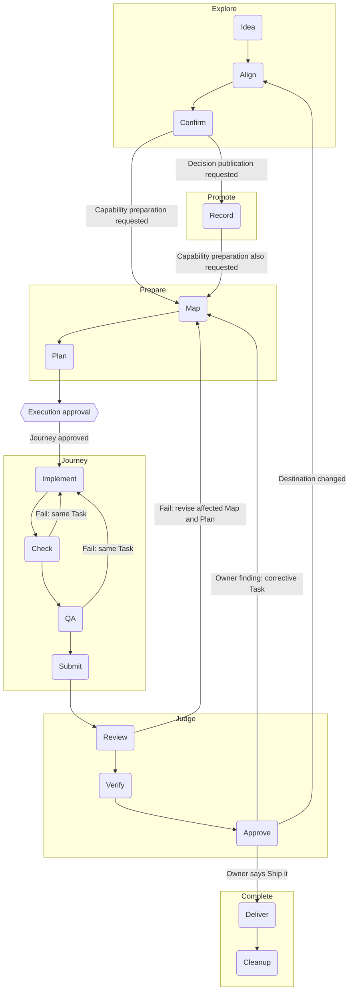

# Workflow reference

Read only the named operation needed by your assignment. Return to the assigned work owner after following its procedure. Definitions remain in the room Glossary.

## Workflows

Look up a workflow verb by name below. Each entry links the verb's definition,
lists its steps in order with the skill or command that carries each, and says
where the workflow loops when a step fails or comes back "not yet". The diagram
maps how the six workflows connect; [Prototype](#prototype) sits outside it.
The entries add no authority and replace no safeguard: the linked skills and
commands carry the procedures.

Maintain these entries with the project's confirmed workflows. When a confirmed
workflow or a verb changes, update its entry here.

| Workflow | Verbs |
|---|---|
| Explore | Idea -> Align -> Confirm |
| Promote | Record -> Publish |
| Prepare | Map -> Plan |
| Journey | Implement -> Check -> QA -> Submit |
| Judge | Review -> Verify -> Approve |
| Complete | Deliver -> Cleanup |

Confirmed means Human Verified Intent; Approved means Human Reviewed Work. Two
owner judgments sit between workflows rather than inside them: the scoped
execution approval that leaves Prepare, and “Ship it”, the permission to deliver
the specific work under discussion. Neither is a stage, and neither substitutes
for Confirm or Approve. The owner takes part through these same verbs; Human QA
is how the owner performs Approve, not an extra stage.

Publication applies around the workflow, without repeated boxes in the map.
Each completed authorized step leaves a durable checkpoint through a PR to
integration. Each run preserves remaining meaningful progress in a PR, with
unfinished status and missing checks clear. [Publish](#publish) ends at checked
integration landing; opening the PR and another host receiving the change are
separate events. A step, handoff or checkpoint does not require a separate agent.



### Align

Defined in the [Glossary](../../../GLOSSARY.md) term **Align**.

**Steps:** ask the most consequential open question with a recommended answer
([grilling](../grilling/SKILL.md#each-decision-in-order)) ->
wait for the owner's answer -> read it back as pending -> lock it once the owner
confirms and update the decision map
([grilling](../grilling/SKILL.md#the-decision-map)) -> repeat
until the frontier is empty.

**Loop:** a corrected readback is revised and read back again before anything
locks; a changed premise reopens only the decisions it affects. Align ends only
at [Confirm](#confirm). An owner send-back at [Judge](#judge) returns here
at the scope it implicates.

### Approve

Defined in the [Glossary](../../../GLOSSARY.md) term **Approve**.

**Steps:** After [Verify](#verify), the owner inspects the integrated candidate
-> record the judgment with `approve S-### --candidate SHA --owner NAME`, or
a finding with `--finding TEXT`
([director](../director/SKILL.md#owner-human-qa-and-main-before-complete)).
The approval binds the same content digest as the passed Review, so
post-delivery bookkeeping keeps it current.

**Loop:** A finding returns corrective Tasks under the open Spec, and the next
candidate needs a fresh Review and approval; a destination change returns to
[Align](#align). Approval grants no delivery: main delivery requires the
owner's Ship it ([Ship](../../../GLOSSARY.md)). It is not the execution
approval that leaves [Prepare](#prepare).

### Check

Defined in the [Glossary](../../../GLOSSARY.md) term **Check**.

**Steps:** Choose checks for the changed behavior and the claim -> run them -> read failures -> [Implement](#implement) the correction -> rerun the affected checks
([implement](../implement/SKILL.md#engineering-and-verification)).
For records and wording, check structure, links, status and source fidelity.
For behavior, run targeted red/green tests and the full applicable integration
gate; this room's full suite is `[FULL_TEST_COMMAND]`.
When the room has an `origin` remote, run
`git fetch --prune origin '+refs/heads/*:refs/remotes/origin/*'` before `doctor`, so
its `remote-id-collision` finding sees every remote branch tip; `doctor` itself
stays offline, and without the integration ref that check does nothing. A
Review finding seen twice becomes a new check through
[improve-harness](../improve-harness/SKILL.md#repeated-review-findings).

**Loop:** A failure stays in the same Task when fixing it serves the same outcome. Preserve partial progress in a PR with failed or missing checks stated; landing waits for its required checks. Reuse evidence only for the candidate and dependencies it covers.

### Cleanup

The last step of [Complete](#complete) in the [workflow map](#workflows),
performing the Glossary's **Clean Up** after [Deliver](#deliver).

**Steps:** Remove the delivery's attributable temporary branches and worktrees
with expected-tip guards, then close the post-delivery cleanup Task with that
proof -> `complete S-###` -> update and validate the capability's Wiki feature
article and reconcile surviving claims into their owners
([director](../director/SKILL.md#documentation-feature-capture-retirement-and-recovery))
-> `retire-spec S-### --wiki PATH` -> once the retired directory is on main,
`discard S-###` when nothing still references it.

**Loop:** `complete` refuses, leaving state untouched, while any post-delivery
Task or acceptance line is unfinished. A missing, invalid or unrouted feature
article blocks `retire-spec` and `discard`; a current reference or a directory
not yet on main blocks `discard`. A later gap against delivered work is a new
Spec, never a revived one.

### Complete

Defined in the [Glossary](../../../GLOSSARY.md) term **Complete**.

**Steps:** [Deliver](#deliver) -> [Cleanup](#cleanup)
([director](../director/SKILL.md#owner-closure-and-reconciliation)).

A Spec records real delivery and cleanup work as Task records carrying
`**Phase:** post-delivery` and acceptance lines under
`### Post-delivery acceptance`
([to-tasks](../to-tasks/SKILL.md#process)). The Spec gate, Review and Approve
do not wait for them; `complete` does.

**Loop:** `complete` refuses, leaving state untouched, until every post-delivery
Task is done with proof, every acceptance line is checked and the approved
content is unchanged on `origin/main`. A later gap is a new Spec under its
landmark or the Blueprint.

### Confirm

Defined in the [Glossary](../../../GLOSSARY.md) term **Confirm**.

**Steps:** Read back the concept, meaning and intended endpoint
([grilling](../grilling/SKILL.md#finishing-honestly)) -> record the owner's
explicit confirmation -> take only the authorized exit: decision publication,
capability preparation or approved implementation
([grilling](../grilling/SKILL.md#exits)).

**Loop:** A correction gets a revised readback; silence never confirms. Confirm ends [Explore](#explore) and establishes understanding. It grants neither implementation permission nor proof of delivery.

### Deliver

Defined in the [Glossary](../../../GLOSSARY.md) term **Deliver**.

**Steps:** Read the owner's Ship it for the specific approved candidate ->
claim the post-delivery Task, which refuses unless a passed Review and the
owner's approval bind the current content -> perform only that authorized main
action -> fetch main and verify the approved content and required checks
([director](../director/SKILL.md#owner-human-qa-and-main-before-complete)).

**Loop:** Without Ship it, stop at integration with the approved candidate
held. A changed candidate or failed required check returns to the affected
work and needs fresh Review and approval. Integration landing alone is not
delivery; “Ship it” authorizes the specific work, not unrelated integration
content.

### Explore

Defined in the [Glossary](../../../GLOSSARY.md) term **Explore**.

**Steps:** [Idea](#idea) -> [Align](#align) -> [Confirm](#confirm)
([grilling](../grilling/SKILL.md)).

**Loop:** Before leaving Explore, obtain explicit owner confirmation of the readback, scope, constraints and endpoint. Until the owner confirms, Explore keeps aligning, and a correction or
a changed premise goes back into Align. Confirm ends Explore; the request determines whether [Promote](#promote),
[Prepare](#prepare) or a nearer endpoint follows.

### Idea

Defined in the [Glossary](../../../GLOSSARY.md) term **Idea**.

**Steps:** take the owner's thought in the owner's words -> explore it in
conversation until it is clear enough to align -> open [Align](#align)
([grilling](../grilling/SKILL.md)).

**Loop:** an idea not yet clear enough to align stays in conversation; nothing
it says is settled until [Confirm](#confirm).

### Implement

Defined in the [Glossary](../../../GLOSSARY.md) term **Implement**.

**Steps:** situate with `doctor`, `next --json` and `show S-###`
([implement](../implement/SKILL.md#1-situate-the-slice)) ->
`claim S-### --agent NAME` -> add the smallest failing test and watch it go
red -> make the smallest change that turns it green, then refactor while green
([implement](../implement/SKILL.md#2-drive-the-behavior)) ->
update the owning documentation and record a `receipt`.

**Loop:** a failed [Check](#check) or [QA](#qa) comes back here in the same
Task. When no confident next action can be established, record the blocker in
the Task and stop.

### Jot

Defined in the [Glossary](../../../GLOSSARY.md) term **Jot**.

**Steps:** capture a useful discovery or owner confirmation, approval or correction
as it arrives, before the next dependent action, in its shared Wiki topic
([jot](../jot/SKILL.md#capture)) -> continue authorized work ->
check completeness and publish the context and its route with authorized work
([jot publication](../jot/SKILL.md#publish-shared-context)). Cold starts
retrieve only relevant topic context ([jot retrieval](../jot/SKILL.md#retrieve-and-continue)).

**Loop:** a refused write saved nothing; reread the revision and repair the
named issue before retrying. A changed claim appends a linked correction.
Legacy JSON readers and structured domain adapters retain their compatibility
route; private-to-tracked migration requires specific exposure approval.

### Journey

Defined in the [Glossary](../../../GLOSSARY.md) term **Journey**.

**Steps:** [Implement](#implement) -> [Check](#check) -> [QA](#qa) ->
[Submit](#submit)
([implement](../implement/SKILL.md#4-review-at-the-relevant-boundary),
once per Task; [carry](../carry/SKILL.md) or a
[handoff](../handoff/SKILL.md) brings an authorized assignment
to it).

**Loop:** a failed Check or QA continues the same Task. [Review](#review), on
the assembled Spec and never on a Task, decides whether another Journey runs:
a failed Review sends the work back through [Map](#map) and [Plan](#plan) into
a new Journey.

### Judge

Defined in the [Glossary](../../../GLOSSARY.md) term **Judge**.

**Steps:** [Review](#review) -> [Verify](#verify) -> [Approve](#approve)
([code-review](../code-review/SKILL.md#independent-review-boundaries),
[dispatcher](../dispatcher/SKILL.md#dispatcher-and-separate-director-assembled-review),
[director](../director/SKILL.md#owner-human-qa-and-main-before-complete)).

Judge binds the frozen pre-delivery artifact. Post-delivery Tasks and
acceptance may still be open; their bookkeeping leaves the review and approval
current, while any substantive change to the Spec or a Task voids both.

**Loop:** A failed Review returns to the affected Map, Plan and Journey under
the open Spec. Owner findings stay open until resolved; a destination change
returns to Align. A passing judgment grants no main authority; [Deliver](#deliver)
needs the owner's explicit Ship it.

### Lane Sweep

Defined in the [Glossary](../../../GLOSSARY.md) term **Lane Sweep**.

Run it at boundaries that already exist: the start of a Director or Dispatcher
session, before and after a Workbench update, before a Spec's assembly, and
on owner request. It is never required: it is no precondition of `next`,
`claim` or `close`, and the Workbench ships no scheduler or background process
for it. An owner may schedule it on their own host.

**Steps:** run `node workbench/tools/lane-sweep.mjs` from a checkout at
integration
([workbench-runtime](../workbench-runtime/SKILL.md#lane-sweep))
-> read each finding -> route it to its owning Spec, where correcting the
record stays that owner's ordinary work -> jot an observation made mid-sweep
on that Spec's Wiki page ([jot](../jot/SKILL.md#capture)).

**Loop:** a finding is a report row and changes nothing by itself, so a lane
its owner has not corrected reports again on the next sweep. When open PRs show
`unavailable`, branches and worktrees are still reported; read the
Limitations and sweep again once `gh` works.

### Map

Defined in the [Glossary](../../../GLOSSARY.md) term **Map**.

**Steps:** read the published decision owners and live Actuality -> reuse the
owning Spec, or take a new ID from `next-id --prefix S --json` -> write the
Spec at `planned`, with no Task and an empty tracked `tasks/`
([to-spec](../to-spec/SKILL.md); a landmark-size destination:
[Landmark Lifecycle](../director/SKILL.md#landmark-lifecycle)) -> `render` and `doctor` ->
state `Map counts: N Specs, M Tasks, K empty tasks/` in the Map record (its PR
body) -> `git fetch origin`, then `doctor --map RECORD` passes on the committed
final tree before publishing.

**Loop:** an unresolved owner choice becomes a Spec blocker, never an invented
answer. A failed [Review](#review) comes back here under the still-open Spec
before Plan and Journey run again.

### Plan

Defined in the [Glossary](../../../GLOSSARY.md) term **Plan**.

**Steps:** Read the Spec and live source and tests -> choose the smallest coherent Task set, often one Task -> write each `TASK.md` with its outcome and planned verification -> keep the prepared Spec at `planned` unless implementation is approved -> `render` and `doctor`
([to-tasks](../to-tasks/SKILL.md#process)).

Mark each Task that delivers or cleans up after Judge with
`**Phase:** post-delivery`, and put its acceptance under
`### Post-delivery acceptance`, so Review and Approve can bind the pre-delivery
work while delivery is pending.

**Loop:** An unanswered scope decision stays in its owner. Prepared work stays available without starting Journey. When implementation is approved, activate explicitly; a necessary repair within the outcome continues the same Task.

### Prepare

Defined in the [Glossary](../../../GLOSSARY.md) term **Prepare**.

**Steps:** [Map](#map) -> [Plan](#plan)
([to-spec](../to-spec/SKILL.md),
[to-tasks](../to-tasks/SKILL.md#process)).

**Loop:** Preserve and publish each completed result under the shared publication rule. Reuse an adequate existing Map or Plan. Before leaving Prepare, present the mapped and planned work, proof and limits and obtain the owner's explicit, scoped execution approval; it is distinct from the later [Approve](#approve) inside Judge. Stop at prepared work unless that approval already covers Journey. One response may satisfy both judgments; [recover sources](execution-authority.md) rather than infer permission.

### Promote

Defined in the [Glossary](../../../GLOSSARY.md) term **Promote**.

**Steps:** [Record](#record) -> [Publish](#publish)
([to-docs](../to-docs/SKILL.md),
[implement](../implement/SKILL.md#branch-completion)).

**Loop:** Correct the affected record and repeat its checks before landing. Stop at the published decision; [Prepare](#prepare) runs only when requested. Interrupted work resumes from its preserved status, without mandatory author or publisher handoffs.

### Prototype

Defined in the [Glossary](../../../GLOSSARY.md) term **Prototype**. Outside the diagram: it fits before [Confirm](#confirm) or between Confirm and [Plan](#plan).

**Steps:** name the one question it answers -> build a throwaway that starts
with one command and shows its state
(the room's run command, the `run` entry of its manifest `legibility`
declaration) -> show the owner the answer -> take the answer back to the verb
it was called from.

**Loop:** the answer returns to Align, Confirm or Map, wherever the question
came from; a question it does not settle gets another prototype or goes back to
the owner. Prototype code reaches the product only through an ordinary
[Journey](#journey).

### Publish

Defined in the [Glossary](../../../GLOSSARY.md) term **Publish**.

**Steps:** Commit meaningful progress -> push and open or update its PR to integration -> run checks appropriate to its content and required review at the assembled capability boundary -> merge when eligible -> fetch integration, prove containment and read the changed owners back
([implement](../implement/SKILL.md#branch-completion)).

**Loop:** A failed check or review returns to the affected work. Keep unfinished or failing progress in a PR with its status clear; do not merge merely to preserve it. Publish is finished only after checked integration landing. A PR opening and another host fetching or pulling are separate events.

### QA

Defined in the [Glossary](../../../GLOSSARY.md) term **QA**.

**Steps:** compare the scoped diff with the Task's outcome and acceptance ->
exercise the real behavior the Task asked for, past what Check proved ->
check the documentation and Receipt claims against the proof -> say what you
judged and what you could not
([implement](../implement/SKILL.md#4-review-at-the-relevant-boundary)).

**Loop:** a defect QA finds goes back to [Implement](#implement) and
[Check](#check) in the same Task; a gap the Task cannot close is named in the
second merge answer as more needed or a new Task.

### Record

Defined in the [Glossary](../../../GLOSSARY.md) term **Record**.

**Steps:** Identify the claim's proper existing owner -> preserve intent, knowledge, decisions, progress or evidence with its source, status and history -> check fidelity and links
([to-docs](../to-docs/SKILL.md)). Text that carries an owner-confirmed readback first records it verbatim as a shared confirmed-intent jot, then wraps the text in `<!-- readback: WIKI_PAGE#JOT-ID -->` and `<!-- /readback -->` lines ([promote](../promote/SKILL.md)); plain `doctor` reports `readback-mismatch` when the region drifts from the entry.

**Loop:** An unsupported claim stays qualified or pending. Correct the record in its owner; recording or publishing a proposal does not make it Canon, prove it works or complete implementation.

### Review

Defined in the [Glossary](../../../GLOSSARY.md) term **Review**.

**Steps:** pin the immutable assembled candidate
([code-review](../code-review/SKILL.md#1-pin-the-review)) ->
`report S-### --candidate SHA` -> a fresh context that built none of it judges
the Spec against its Map
([code-review](../code-review/SKILL.md#independent-review-boundaries))
-> record `verdict S-### --candidate SHA --digest DIGEST --result pass|fail`
([dispatcher](../dispatcher/SKILL.md#dispatcher-and-separate-director-assembled-review)).

`report` names missing evidence for a checked standard closing named-verification/
limitations line or an explicit Full-suite acceptance line. After the latest
Task-close row (including a continued run), a Verification cell must name a
full 40-hex candidate and an applicable check with an explicit result. Focused
checks satisfy the standard line, but not a Full-suite promise. Row order,
not dates, decides which evidence is later. Fresh and reused evidence retain
their stated provenance; text alone does not prove execution. A new `pass`
on this gap refuses before any verdict write; failed verdicts and unrelated
report gaps keep their existing behavior. With no Task close, this check adds
no gap and imposes no new per-Task Full-suite requirement.

**Loop:** a fail sends each finding back as `continue TK-###:` or `new Task:`
through [Map](#map) and [Plan](#plan) under the still-open Spec, and the next
candidate gets a fresh Review
([corrective return](../dispatcher/SKILL.md#assembled-review-and-corrective-return));
a pass merges to integration for [Verify](#verify). Post-delivery Tasks may
still be open when Review passes. The same Review failure
twice, or three attempts with no real progress, blocks and escalates.

### Submit

Defined in the [Glossary](../../../GLOSSARY.md) term **Submit**.

**Steps:** record the `receipt`, then commit and push the candidate ->
`close S-### --agent NAME`, `render` and `doctor`, and push that evidence
([implement](../implement/SKILL.md#worker-selection-implementation-and-hand-back))
-> open the merge request into the parent branch (today `integration`) with
the two [merge answers](../implement/SKILL.md#4-review-at-the-relevant-boundary).

**Loop:** the Dispatcher, Director or next agent in the Spec validates the
answers against the diff and merges when they hold and the merge is green;
otherwise the current run fixes its assignment or hands the remaining gap to
the Spec's orchestrator for a new single-run Task, after
[reconciliation](../to-tasks/sizing.md). Several validated Task PRs land one at a time through the merge train
in [Branch completion](../implement/SKILL.md#branch-completion):
each is brought onto the integration tip at its turn without a force-push,
its diff checked unchanged and its suite run on that head before it merges. A
rebased or updated Task runs its Journey again and never gets a Review of its
own.

### Verify

Defined in the [Glossary](../../../GLOSSARY.md) term **Verify**.

**Steps:** Check the assembled candidate's gate, which awaits every pre-delivery Task and acceptance line but no post-delivery one, and merge eligibility -> land it on integration -> fetch and prove the reviewed commit is contained -> check the landed result
([dispatcher](../dispatcher/SKILL.md#dispatcher-and-separate-director-assembled-review),
[implement](../implement/SKILL.md#branch-completion)).

**Loop:** A changed candidate needs the applicable fresh Review before landing. A failure returns to the affected work. [Approve](#approve) follows; main verification belongs to [Deliver](#deliver) after the owner's Ship it, and integration verification does not provide it.

## Workspace closeout

Use this at Publish, pause, blocked publication, handoff and end-of-assignment,
and recheck the selected work before main delivery. It accounts for the current
assignment even when its code cannot land. It does not complete a Spec or grant
removal, publication or main authority.

1. At the claimed assignment's start, resolve the existing Spec/Task and private
   recovery collection through the manifest. Capture the starting inventory:

   ```bash
   node workbench/tools/workspace-closeout.mjs snapshot --project . --spec S-### --task TK-### --owner NAME --ignored RELATIVE_PRIVATE_PATH > "$CLOSEOUT_START"
   ```

   Repeat `--ignored` for relevant ignored evidence. Keep the snapshot in approved
   private recovery outside any checkout selected for removal; it contains local
   paths and hashes. Record its returned `digest` as `Workspace baseline
   sha256:DIGEST` in the existing Task Receipt, commit that owner record and retain
   its immutable commit as `CLOSEOUT_BASE`. The snapshot is evidence from its
   observer, not authenticated history. A missing starting inventory leaves the
   pre-existing boundary unverified; do not reconstruct it as a fresh start.

2. Compare ending state with that inventory. Preserve inherited work. Give every
   owned path, staged version, ref and stash a disposition in the existing
   work owner: integrated; pushed pending with a routed continuation; private
   local-only recovery; or blocked with its retained bytes and reason. Reconcile
   useful intent and knowledge through `jot` and `to-docs`. Review privacy before
   publishing; snapshots and raw private recovery stay private.

3. Put the corresponding check inputs in an ordinary local JSON artifact,
   `{ "schemaVersion": 1, "items": [...] }`. Entries name `kind` (`path`, `index`,
   `ref`, `stash` or `worktree`), `path` or source identity, and `state`. Integrated/pending
   entries name the exact `commit` and pending `ref` (`refs/heads/...`); a ref or
   stash entry uses `source` for its original ref or stash commit. A local-only
   path names an independent `copy` outside the removable checkout and a
   `reason`; blocked paths name their reason. An added or changed foreign
   worktree needs a retained disposition with its actual `expectedHead` and
   purpose; the checker preserves its activity boundary. These inputs declare claims;
   the checker compares actual bytes, modes, objects and live remote tips.

4. Fetch the required existing refs through the room's Git procedure, then run:

   ```bash
   node workbench/tools/workspace-closeout.mjs check --project . --baseline "$CLOSEOUT_START" --baseline-commit "$CLOSEOUT_BASE" --dispositions "$CLOSEOUT_DISPOSITIONS"
   ```

   Pending work needs exact remote bytes plus an integration-published route
   from the ordinary entry to its owner, with candidate/ref, checks, authority
   and next action. Publish that safe owner record independently of failing
   code. Git records executable/link mode, not arbitrary filesystem permissions;
   regular modes other than 0644/0755 need private recovery and remain local-only.
   Links use the local host default (observed 0755 on macOS); native Windows
   permission behavior remains unverified. Staged-only local
   copy claims stay unsupported until verified through a named Git candidate.
   Unchanged inherited bytes are retained, not remotely recoverable, unless their
   exact object is in verified remote history. Local-only, missing, changed,
   unexplained or unavailable evidence stays incomplete. Correct the cause and rerun; never weaken the check or discard
   evidence. Record the result and limits in the existing Spec/Task.

5. Keep accounting, remote recovery and workspace release distinct. The checker
   observes Git state, leaves host activity unverified and never removes work.
   Obtain the current named-writer handback and inspect the owning host's active
   use before release. Unknown or active use retains the checkout. Preserve all
   necessary ignored bytes first. Use the app lifecycle for managed worktrees;
   for project worktrees use Git worktree operations. Retain unmerged recovery
   branches, recheck expected tips before any allowed merged-branch deletion,
   and verify actual removal separately. Main permission remains unchanged.
