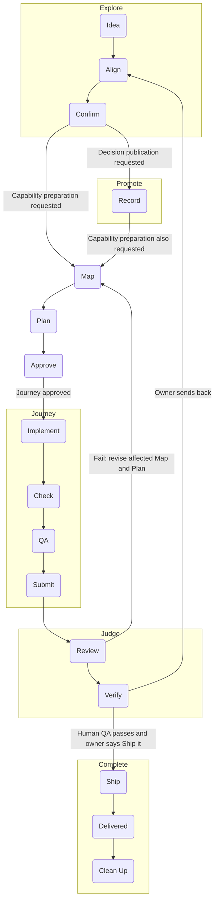

# Workflow reference

Read only the named operation needed by your assignment. Return to the assigned work owner after following its procedure. Definitions remain in the room Lexicon.

## Workflows

Look up a workflow verb by name below. Each entry links the verb's definition,
lists its steps in order with the skill or command that carries each, and says
where the workflow loops when a step fails or comes back "not yet". The diagram
maps how the five parent workflows connect; [Prototype](#prototype) sits
outside it. The entries add no authority and replace no safeguard: the linked
skills and commands carry the procedures.

Maintain these entries with the project's confirmed workflows. When a confirmed
workflow or a verb changes, update its entry here.

Publication applies around the workflow, without repeated boxes in the map.
Each completed authorized step leaves a durable checkpoint through a PR to
integration. Each run preserves remaining meaningful progress in a PR, with
unfinished status and missing checks clear. [Publish](#publish) ends at checked
integration landing; opening the PR and another host receiving the change are
separate events. A step, handoff or checkpoint does not require a separate agent.

### Align

Defined in the [Lexicon](../../../LEXICON.md) row **Align**.

**Steps:** ask the most consequential open question with a recommended answer
([grilling](../grilling/SKILL.md#each-decision-in-order)) ->
wait for the owner's answer -> read it back as pending -> lock it once the owner
confirms and update the decision map
([grilling](../grilling/SKILL.md#the-decision-map)) -> repeat
until the frontier is empty.

**Loop:** a corrected readback is revised and read back again before anything
locks; a changed premise reopens only the decisions it affects. Align ends only
at [Confirm](#confirm). An owner send-back at [Judge](#judge) returns here
at the scope it implicates.

### Approve

Defined in the [Lexicon](../../../LEXICON.md) row **Approve**.

**Steps:** Record the owner's permission and its stated scope in the existing work owner -> proceed with that work, including [Journey](#journey) when authorized
([implement](../implement/SKILL.md#work-selection-and-lifecycle)).
Confirmation and approval may occur together; reuse authority already given.

**Loop:** If permission for the next action is absent or the scope changes, preserve the prepared work and resolve that boundary. Ordinary approval stops before main; main delivery requires [Ship](#ship).

### Check

Defined in the [Lexicon](../../../LEXICON.md) row **Check**.

**Steps:** Choose checks for the changed behavior and the claim -> run them -> read failures -> [Implement](#implement) the correction -> rerun the affected checks
([implement](../implement/SKILL.md#engineering-and-verification)).
For records and wording, check structure, links, status and source fidelity.
For behavior, run targeted red/green tests and the full applicable integration
gate; this room's full suite is `[FULL_TEST_COMMAND]`.
When the room has an `origin` remote, run
`git fetch --prune origin '+refs/heads/*:refs/remotes/origin/*'` before `doctor`, so
its `remote-id-collision` finding sees every remote branch tip; `doctor` itself
stays offline, and without the integration ref that check does nothing. A
Review finding seen twice becomes a new check through
[improve-harness](../improve-harness/SKILL.md#repeated-review-findings).

**Loop:** A failure stays in the same Task when fixing it serves the same outcome. Preserve partial progress in a PR with failed or missing checks stated; landing waits for its required checks. Reuse evidence only for the candidate and dependencies it covers.

### Clean Up

Defined in the [Lexicon](../../../LEXICON.md) row **Clean Up**.

**Steps:** write and validate the capability's Wiki feature article and
reconcile surviving claims into their owners
([director](../director/SKILL.md#documentation-feature-capture-retirement-and-recovery))
-> `retire-spec S-### --wiki PATH` -> once the retired directory is on main,
`discard S-###` when nothing still references it.

**Loop:** a missing, invalid or unrouted feature article blocks `retire-spec`
and `discard` until it is written; a current reference or a directory not yet
on main blocks `discard`. A later gap against delivered work is a new Spec,
never a revived one.

### Complete

Defined in the [Lexicon](../../../LEXICON.md) row **Complete**.

**Steps:** [Ship](#ship) -> [Delivered](#delivered) -> [Clean Up](#clean-up)
([director](../director/SKILL.md#owner-closure-and-reconciliation)).

**Loop:** `complete` refuses, leaving state untouched, until the approved
content is unchanged on `origin/main`; Clean Up waits for completion. A later
gap is a new Spec under its landmark or the Blueprint.

### Confirm

Defined in the [Lexicon](../../../LEXICON.md) row **Confirm**.

**Steps:** Read back the concept, meaning and intended endpoint
([grilling](../grilling/SKILL.md#finishing-honestly)) -> record the owner's
explicit confirmation -> take only the authorized exit: decision publication,
capability preparation or approved implementation
([grilling](../grilling/SKILL.md#exits)).

**Loop:** A correction gets a revised readback; silence never confirms. Confirm ends [Explore](#explore) and establishes understanding. It grants neither implementation permission nor proof of delivery.

### Delivered

Defined in the [Lexicon](../../../LEXICON.md) row **Delivered**.

**Steps:** After the owner-authorized [Ship](#ship), fetch main -> verify the authorized content and required checks -> `complete S-###` -> `render` and `doctor`
([director](../director/SKILL.md#owner-human-qa-and-main-before-complete)).

**Loop:** `complete` refuses until its Task, acceptance, review, Human QA and main-containment gates pass. Integration landing alone does not complete the Spec or authorize main.

### Explore

Defined in the [Lexicon](../../../LEXICON.md) row **Explore**.

**Steps:** [Idea](#idea) -> [Align](#align) -> [Confirm](#confirm)
([grilling](../grilling/SKILL.md)).

**Loop:** until the owner confirms, Explore keeps aligning, and a correction or
a changed premise goes back into Align. Confirm ends Explore; the request determines whether [Promote](#promote),
[Prepare](#prepare) or a nearer endpoint follows.

### Idea

Defined in the [Lexicon](../../../LEXICON.md) row **Idea**.

**Steps:** take the owner's thought in the owner's words -> explore it in
conversation until it is clear enough to align -> open [Align](#align)
([grilling](../grilling/SKILL.md)).

**Loop:** an idea not yet clear enough to align stays in conversation; nothing
it says is settled until [Confirm](#confirm).

### Implement

Defined in the [Lexicon](../../../LEXICON.md) row **Implement**.

**Steps:** situate with `doctor`, `next --json` and `show S-###`
([implement](../implement/SKILL.md#1-situate-the-slice)) ->
`claim S-### --agent NAME` -> add the smallest failing test and watch it go
red -> make the smallest change that turns it green, then refactor while green
([implement](../implement/SKILL.md#2-drive-the-behavior)) ->
update the owning documentation and record a `receipt`.

**Loop:** a failed [Check](#check) or [QA](#qa) comes back here in the same
Task. When no confident next action can be established, record the blocker in
the Task and stop.

### Jot

Defined in the [Lexicon](../../../LEXICON.md) row **Jot**.

**Steps:** capture a useful discovery or owner confirmation, approval or correction
as it arrives, before the next dependent action, in its shared Wiki topic
([jot](../jot/SKILL.md#capture)) -> continue authorized work ->
check completeness and publish the context and its route with authorized work
([jot publication](../jot/SKILL.md#publish-shared-context)). Cold starts
retrieve only relevant topic context ([jot retrieval](../jot/SKILL.md#retrieve-and-continue)).

**Loop:** a refused write saved nothing; reread the revision and repair the
named issue before retrying. A changed claim appends a linked correction.
Legacy JSON readers and structured domain adapters retain their compatibility
route; private-to-tracked migration requires specific exposure approval.

### Journey

Defined in the [Lexicon](../../../LEXICON.md) row **Journey**.

**Steps:** [Implement](#implement) -> [Check](#check) -> [QA](#qa) ->
[Submit](#submit)
([implement](../implement/SKILL.md#4-review-at-the-relevant-boundary),
once per Task; [carry](../carry/SKILL.md) or a
[handoff](../handoff/SKILL.md) brings an authorized assignment
to it).

**Loop:** a failed Check or QA continues the same Task. [Review](#review), on
the assembled Spec and never on a Task, decides whether another Journey runs:
a failed Review sends the work back through [Map](#map) and [Plan](#plan) into
a new Journey.

### Judge

Defined in the [Lexicon](../../../LEXICON.md) row **Judge**.

**Steps:** [Review](#review) -> [Verify](#verify)
([code-review](../code-review/SKILL.md#independent-review-boundaries),
[dispatcher](../dispatcher/SKILL.md#dispatcher-and-separate-director-assembled-review)).

The owner evaluates the result in Human QA. The legacy `approve S-###
--candidate SHA --owner NAME` command records that content judgment
([director](../director/SKILL.md#owner-human-qa-and-main-before-complete)).

**Loop:** A failed Review returns to the affected Map, Plan and Journey under the open Spec. Human QA findings stay open until resolved; a destination change returns to Align. A passing judgment grants no main authority; [Ship](#ship) needs the owner's explicit permission.

### Lane Sweep

Defined in the [Lexicon](../../../LEXICON.md) row **Lane Sweep**.

Run it at boundaries that already exist: the start of a Director or Dispatcher
session, before and after a Workbench update, before a Spec's assembly, and
on owner request. It is never required: it is no precondition of `next`,
`claim` or `close`, and the Workbench ships no scheduler or background process
for it. An owner may schedule it on their own host.

**Steps:** run `node workbench/tools/lane-sweep.mjs` from a checkout at
integration
([workbench-runtime](../workbench-runtime/SKILL.md#lane-sweep))
-> read each finding -> route it to its owning Spec, where correcting the
record stays that owner's ordinary work -> jot an observation made mid-sweep
on that Spec's Wiki page ([jot](../jot/SKILL.md#capture)).

**Loop:** a finding is a report row and changes nothing by itself, so a lane
its owner has not corrected reports again on the next sweep. When open PRs show
`unavailable`, branches and worktrees are still reported; read the
Limitations and sweep again once `gh` works.

### Map

Defined in the [Lexicon](../../../LEXICON.md) row **Map**.

**Steps:** read the published decision owners and live Actuality -> reuse the
owning Spec, or take a new ID from `next-id --prefix S --json` -> write the
Spec at `planned`, with no Task and an empty tracked `tasks/`
([to-spec](../to-spec/SKILL.md); a landmark-size destination:
[Landmark Lifecycle](../director/SKILL.md#landmark-lifecycle)) -> `render` and `doctor` ->
state `Map counts: N Specs, M Tasks, K empty tasks/` in the Map record (its PR
body) -> `git fetch origin`, then `doctor --map RECORD` passes on the committed
final tree before publishing.

**Loop:** an unresolved owner choice becomes a Spec blocker, never an invented
answer. A failed [Review](#review) comes back here under the still-open Spec
before Plan and Journey run again.

### Plan

Defined in the [Lexicon](../../../LEXICON.md) row **Plan**.

**Steps:** Read the Spec and live source and tests -> choose the smallest coherent Task set, often one Task -> write each `TASK.md` with its outcome and planned verification -> keep the prepared Spec at `planned` unless implementation is approved -> `render` and `doctor`
([to-tasks](../to-tasks/SKILL.md#process)).

**Loop:** An unanswered scope decision stays in its owner. Prepared work stays available without starting Journey. When implementation is approved, activate explicitly; a necessary repair within the outcome continues the same Task.

### Prepare

Defined in the [Lexicon](../../../LEXICON.md) row **Prepare**.

**Steps:** [Map](#map) -> [Plan](#plan)
([to-spec](../to-spec/SKILL.md),
[to-tasks](../to-tasks/SKILL.md#process)).

**Loop:** Preserve and publish each completed result under the shared publication rule. Reuse an adequate existing Map or Plan. Stop at prepared work unless Journey is already approved.

### Promote

Defined in the [Lexicon](../../../LEXICON.md) row **Promote**.

**Steps:** [Record](#record) -> [Publish](#publish)
([to-docs](../to-docs/SKILL.md),
[implement](../implement/SKILL.md#branch-completion)).

**Loop:** Correct the affected record and repeat its checks before landing. Stop at the published decision; [Prepare](#prepare) runs only when requested. Interrupted work resumes from its preserved status, without mandatory author or publisher handoffs.

### Prototype

Defined in the [Lexicon](../../../LEXICON.md) row **Prototype**. Outside the diagram: it fits before [Confirm](#confirm) or between Confirm and [Plan](#plan).

**Steps:** name the one question it answers -> build a throwaway that starts
with one command and shows its state
(the room's run command, the `run` entry of its manifest `legibility`
declaration) -> show the owner the answer -> take the answer back to the verb
it was called from.

**Loop:** the answer returns to Align, Confirm or Map, wherever the question
came from; a question it does not settle gets another prototype or goes back to
the owner. Prototype code reaches the product only through an ordinary
[Journey](#journey).

### Publish

Defined in the [Lexicon](../../../LEXICON.md) row **Publish**.

**Steps:** Commit meaningful progress -> push and open or update its PR to integration -> run checks appropriate to its content and required review at the assembled capability boundary -> merge when eligible -> fetch integration, prove containment and read the changed owners back
([implement](../implement/SKILL.md#branch-completion)).

**Loop:** A failed check or review returns to the affected work. Keep unfinished or failing progress in a PR with its status clear; do not merge merely to preserve it. Publish is finished only after checked integration landing. A PR opening and another host fetching or pulling are separate events.

### QA

Defined in the [Lexicon](../../../LEXICON.md) row **QA**.

**Steps:** compare the scoped diff with the Task's outcome and acceptance ->
exercise the real behavior the Task asked for, past what Check proved ->
check the documentation and Receipt claims against the proof -> say what you
judged and what you could not
([implement](../implement/SKILL.md#4-review-at-the-relevant-boundary)).

**Loop:** a defect QA finds goes back to [Implement](#implement) and
[Check](#check) in the same Task; a gap the Task cannot close is named in the
second merge answer as more needed or a new Task.

### Record

Defined in the [Lexicon](../../../LEXICON.md) row **Record**.

**Steps:** Identify the claim's proper existing owner -> preserve intent, knowledge, decisions, progress or evidence with its source, status and history -> check fidelity and links
([to-docs](../to-docs/SKILL.md)). Text that carries an owner-confirmed readback first records it verbatim as a shared confirmed-intent jot, then wraps the text in `<!-- readback: WIKI_PAGE#JOT-ID -->` and `<!-- /readback -->` lines ([promote](../promote/SKILL.md)); plain `doctor` reports `readback-mismatch` when the region drifts from the entry.

**Loop:** An unsupported claim stays qualified or pending. Correct the record in its owner; recording or publishing a proposal does not make it Canon, prove it works or complete implementation.

### Review

Defined in the [Lexicon](../../../LEXICON.md) row **Review**.

**Steps:** pin the immutable assembled candidate
([code-review](../code-review/SKILL.md#1-pin-the-review)) ->
`report S-### --candidate SHA` -> a fresh context that built none of it judges
the Spec against its Map
([code-review](../code-review/SKILL.md#independent-review-boundaries))
-> record `verdict S-### --candidate SHA --digest DIGEST --result pass|fail`
([dispatcher](../dispatcher/SKILL.md#dispatcher-and-separate-director-assembled-review)).

`report` names missing evidence for a checked standard closing named-verification/
limitations line or an explicit Full-suite acceptance line. After the latest
Task-close row (including a continued run), a Verification cell must name a
full 40-hex candidate and an applicable check with an explicit result. Focused
checks satisfy the standard line, but not a Full-suite promise. Row order,
not dates, decides which evidence is later. Fresh and reused evidence retain
their stated provenance; text alone does not prove execution. A new `pass`
on this gap refuses before any verdict write; failed verdicts and unrelated
report gaps keep their existing behavior. With no Task close, this check adds
no gap and imposes no new per-Task Full-suite requirement.

**Loop:** a fail sends each finding back as `continue TK-###:` or `new Task:`
through [Map](#map) and [Plan](#plan) under the still-open Spec, and the next
candidate gets a fresh Review
([corrective return](../dispatcher/SKILL.md#assembled-review-and-corrective-return));
a pass merges to integration for [Verify](#verify). The same Review failure
twice, or three attempts with no real progress, blocks and escalates.

### Ship

Defined in the [Lexicon](../../../LEXICON.md) row **Ship**.

**Steps:** Read the owner's explicit permission for the specific main delivery -> verify its candidate, required checks and integration state -> perform only that authorized main action -> verify main containment
([director](../director/SKILL.md#owner-human-qa-and-main-before-complete)).

**Loop:** Without explicit main authority, stop at integration. A changed candidate or failed required check returns to the affected work. “Ship it” authorizes the specific work under discussion, not unrelated integration content.

### Submit

Defined in the [Lexicon](../../../LEXICON.md) row **Submit**.

**Steps:** record the `receipt`, then commit and push the candidate ->
`close S-### --agent NAME`, `render` and `doctor`, and push that evidence
([implement](../implement/SKILL.md#worker-selection-implementation-and-hand-back))
-> open the merge request into the parent branch (today `integration`) with
the two [merge answers](../implement/SKILL.md#4-review-at-the-relevant-boundary).

**Loop:** the Dispatcher, Director or next agent in the Spec validates the
answers against the diff and merges when they hold and the merge is green;
otherwise the same Task continues with an adjusted handoff, or a new Task is
named. Several validated Task PRs land one at a time through the merge train
in [Branch completion](../implement/SKILL.md#branch-completion):
each is brought onto the integration tip at its turn without a force-push,
its diff checked unchanged and its suite run on that head before it merges. A
rebased or updated Task runs its Journey again and never gets a Review of its
own.

### Verify

Defined in the [Lexicon](../../../LEXICON.md) row **Verify**.

**Steps:** Check the assembled candidate's gate and merge eligibility -> land it on integration -> fetch and prove the reviewed commit is contained -> check the landed result
([dispatcher](../dispatcher/SKILL.md#dispatcher-and-separate-director-assembled-review),
[implement](../implement/SKILL.md#branch-completion)).

**Loop:** A changed candidate needs the applicable fresh Review before landing. A failure returns to the affected work. Main verification comes after explicit [Ship](#ship) authorization; integration verification does not provide it.

